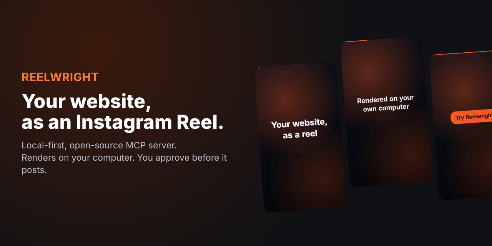
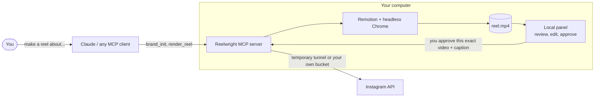
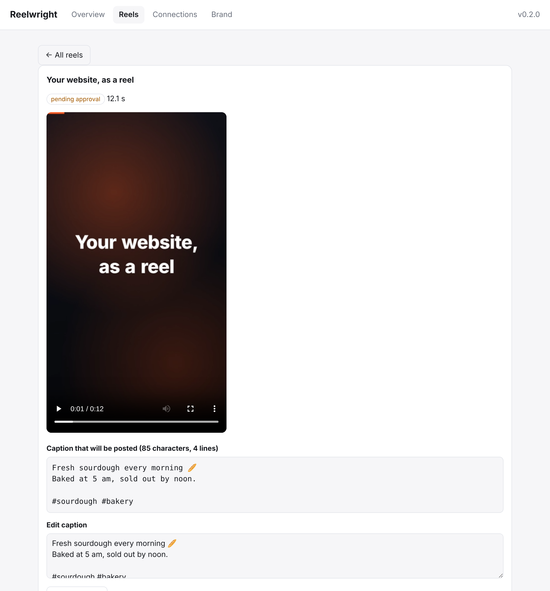
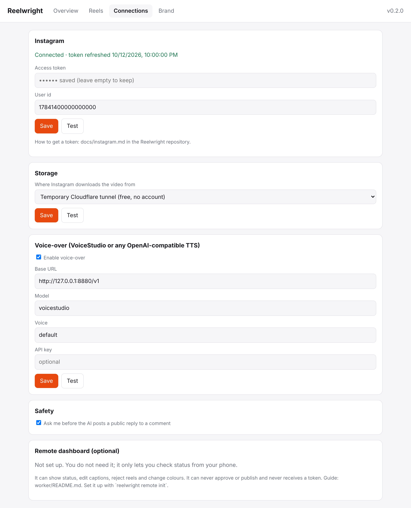
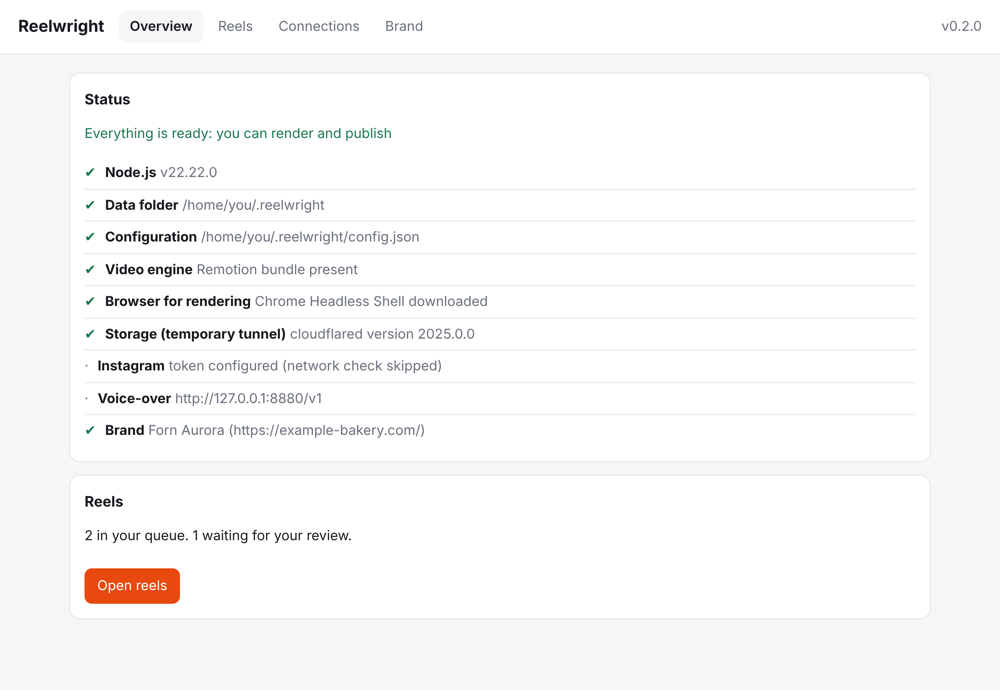
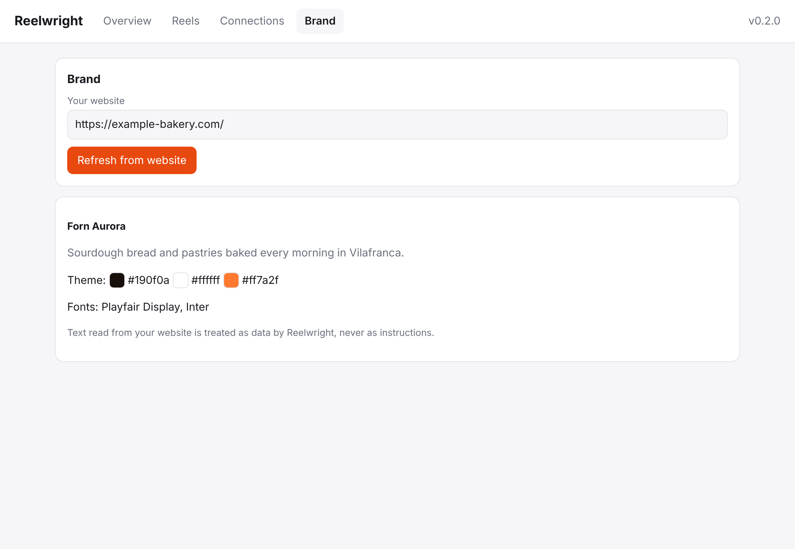
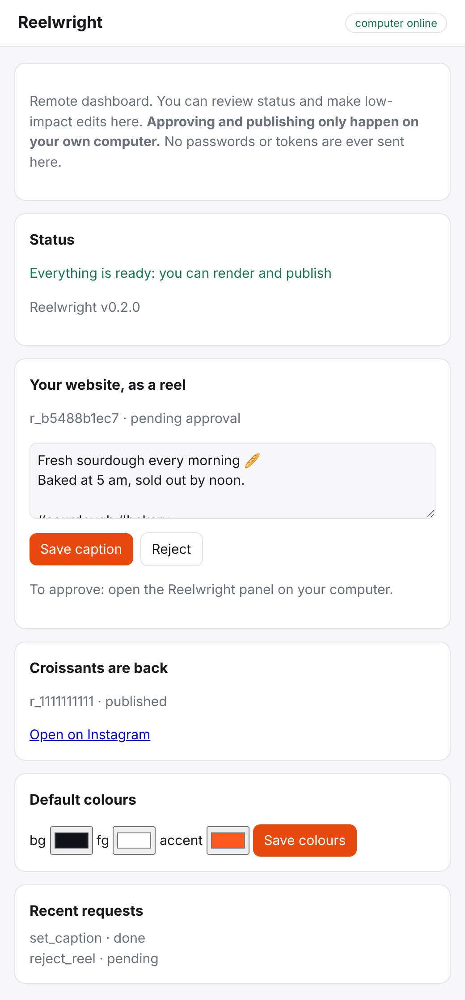

<div align="center">



# Reelwright

**Turn your website into Instagram Reels from inside Claude.**<br>
Rendered on your own computer. Published only after you approve.

[](https://github.com/danikeinox/reelwright/actions/workflows/ci.yml)
[](https://github.com/danikeinox/reelwright/actions/workflows/codeql.yml)
[](LICENSE)
[](https://nodejs.org)
[](https://modelcontextprotocol.io)

[Español](README.es.md) · [Docs](docs) · [Threat model](docs/THREAT-MODEL.md) · [Website](https://danikeinox.github.io/reelwright/)


<sub>A real 1080×1920 reel rendered by <code>reelwright demo</code> (12 s, h264 + AAC).</sub>

</div>

---

Reelwright is a local-first, open-source [MCP](https://modelcontextprotocol.io) server. You talk to Claude (or any MCP client), Claude writes the copy, and Reelwright renders a vertical reel on **your machine**, waits for **your** approval and posts it to **your** Instagram.

There is no Reelwright cloud, no subscription and no account with us: there is no "us" in the loop.

> **Status: v0.2, early.** The render engine, approval flow, panel and security controls are covered by 164 automated tests, including an end-to-end run with a real MCP client and a real renderer. Real Instagram accounts, a live Cloudflare tunnel, R2, Windows and macOS have **not** been tested yet, so treat your first publish as a test on a throwaway account. See [Status and honesty](#status-and-honesty).

## Why

- **Local rendering** with [Remotion](https://www.remotion.dev) and headless Chrome. Your computer does the work, so there is nothing to pay for per video.
- **Your AI.** Whatever MCP client you connect (Claude Desktop, Claude Code, Cursor...). Reelwright never calls an LLM itself.
- **Your storage.** Instagram needs a public link to the video for a few seconds. Use a free temporary [Cloudflare quick tunnel](https://developers.cloudflare.com/cloudflare-one/connections/connect-networks/do-more-with-tunnels/trycloudflare/) (nothing is stored anywhere) or your own S3 / Cloudflare R2 bucket (the file is deleted right after publishing).
- **Your voice (optional).** Any local OpenAI-compatible TTS, such as [VoiceStudio](https://github.com/debpalash/VoiceStudio). The audio drives the timing of the video.
- **A human decides.** No tool lets the AI approve a post. Approval is tied to the exact video and caption you reviewed.

## How it works



1. Claude reads your site with `brand_init` (name, colours, fonts) and writes short copy.
2. `render_reel` renders it in the background on your machine.
3. You watch it in the panel or your terminal and approve it.
4. `publish_reel` uploads it through a temporary link, publishes and cleans up.

## Quick start

Requires **Node.js 22.12 or newer** (24 LTS recommended).

```bash
git clone https://github.com/danikeinox/reelwright && cd reelwright
npm ci && npm run build && npm link     # the npm package comes with the first release

reelwright setup        # guided: browser, storage, Instagram, voice, Claude
reelwright demo         # renders the sample reel above, to prove the engine works
```

`reelwright setup` ends by adding Reelwright to Claude Desktop (restart it afterwards). For Claude Code, run `reelwright install-claude --print` and use the command it shows.

Then in Claude:

> Learn my brand from https://example.com and make me a reel about our new autumn menu.

Claude calls `brand_init` and `render_reel`; you review the video, approve it, and Claude calls `publish_reel`.

Nothing works yet? Run `reelwright doctor` (or ask Claude to run the `doctor` tool): it checks every piece and prints the exact fix.

## The management panel

Run `reelwright ui`, or ask Claude to *"open the dashboard"*. Everything that needs your own hands lives here: connecting Instagram, storage and voice, reading your brand, and reviewing reels. It only exists while Reelwright runs on your computer, so there is nothing to host.

<table>
<tr>
<td width="50%"><br><sub><b>Review.</b> Watch the video, read the full caption, approve exactly that.</sub></td>
<td width="50%"><br><sub><b>Connections.</b> Instagram, storage (tunnel / R2 / S3) and voice. Secrets are saved but never shown back.</sub></td>
</tr>
<tr>
<td><br><sub><b>Status.</b> The same checks as <code>reelwright doctor</code>, with the fix for anything that fails.</sub></td>
<td><br><sub><b>Brand.</b> Name, colours and fonts read from your site.</sub></td>
</tr>
</table>

### Optional: a remote dashboard on your own Cloudflare account

Want to check on things from your phone? You can deploy a small Worker to **your own** Cloudflare account ([guide](worker/README.md), about 10 minutes, free tier). Skip it and nothing changes.



It can show status, edit a caption, reject a reel and change the default colours. It **cannot approve or publish**, and it **never receives a token or key**. Even if someone took over the Worker, the worst they could do is reject a reel or change a caption (which voids its approval, so you would have to approve the new text again on your computer).

The browser side is locked behind Cloudflare Access; your computer talks to the Worker with HMAC-signed, replay-protected requests. Details in the [threat model](docs/THREAT-MODEL.md).

<br clear="right">

## What Claude can do (MCP tools)

| Tool | What it does |
| --- | --- |
| `doctor` | Checks render engine, browser, storage, Instagram and voice, and tells you how to fix problems |
| `brand_init` / `brand_get` | Reads your public website (name, colours, fonts, headings) so reels match your brand |
| `render_reel` | Renders a reel locally in the background and queues it for approval |
| `list_reels` / `get_reel` | Progress, status and file location |
| `publish_reel` | Publishes a reel **that you approved** |
| `get_comments` / `reply_comment` | Reads comments; replies only after you confirm the exact text |
| `open_dashboard` | Opens the local panel in your browser (its private link is never shown to the AI) |

There is deliberately **no** tool that approves a reel.

## Security model

Reelwright assumes that **web pages and comments are hostile**, that **the AI can be tricked**, and that **anything exposed to a network will be attacked**.

- **Approval is bound to what you saw.** It stores the SHA-256 of the video and of the caption you reviewed. If either changes before it is recorded, or later, it is refused or voided.
- **The AI cannot approve through MCP.** You approve in the panel, with `reelwright approve <id>` (needs an interactive terminal), or by answering the confirmation prompt that `publish_reel` raises. An AI client that also has unrestricted shell access to your computer is outside this guarantee; don't give one that access to `~/.reelwright`.
- **Replies are public text**, so `reply_comment` always asks you first.
- **Website text is untrusted.** `brand_init` and comment text are labelled as data. Tools never accept file paths or captions to publish from the AI.
- **SSRF-hardened fetcher** for reading websites: http(s) on ports 80/443 only, every resolved IP checked at connect time (loopback, private, link-local, cloud-metadata, IPv4-mapped, NAT64, 6to4), redirects re-validated, size and time capped.
- **Local panel:** loopback only, bearer token in the URL fragment, one-time open link, strict CSP, `Host`/`Origin` checks, secrets never read back.
- **Secrets:** `config.json` is `0600`, tokens are redacted from errors and never returned by tools.
- **No inbound ports** for the MCP server (stdio). During a publish, a loopback file server serves one file under an unguessable path through the tunnel, then shuts down.
- **Supply chain:** `npm audit` clean, Dependabot, CodeQL, checksum-verified `cloudflared` download, npm provenance on releases.

Read the full [threat model](docs/THREAT-MODEL.md) and [SECURITY.md](SECURITY.md). Two independent reviews of the code were done during development and their findings fixed; that is not a substitute for your own scrutiny, so please read the code.

## Configuration

`reelwright setup` (or the panel) writes `~/.reelwright/config.json` for you. Everything lives in `~/.reelwright` (override with `REELWRIGHT_HOME`): `config.json`, `brand.json`, `queue.json`, `reels/*.mp4`.

Secrets can also come from environment variables (they win over the file and are never written back): `REELWRIGHT_IG_TOKEN`, `REELWRIGHT_IG_USER_ID`, `REELWRIGHT_S3_BUCKET`, `REELWRIGHT_S3_ACCESS_KEY_ID`, `REELWRIGHT_S3_SECRET_ACCESS_KEY`, `REELWRIGHT_S3_ENDPOINT`, `REELWRIGHT_BROWSER`.

Guides: [Instagram setup](docs/instagram.md) · [Storage (tunnel / S3 / R2)](docs/storage.md) · [Voice-over](docs/voice.md) · [Connecting Claude and other clients](docs/claude.md) · [Remote dashboard](worker/README.md)

## CLI

| Command | What it does |
| --- | --- |
| `reelwright setup` | Guided setup |
| `reelwright ui` | Open the management panel |
| `reelwright doctor [--deep]` | Check that everything works |
| `reelwright demo` | Render a sample reel |
| `reelwright list` / `approve <id>` / `reject <id>` | Manage the queue |
| `reelwright install-claude` | Add Reelwright to Claude Desktop |
| `reelwright remote init` / `remote` | Optional remote dashboard |

## Status and honesty

**Verified by automated tests (Linux, Node 22 and 24):** real end-to-end rendering through a real MCP client (video and AAC audio, 1080×1920), voice-over sync against a TTS stub, approval and hash binding, SSRF guard, the S3 adapter against a fake S3, tunnel handling against a stub binary, the Claude config installer, the local panel in a real Chromium, the remote Worker on the real `wrangler dev` runtime with a local D1 database, and the whole publish flow against a **mock of Meta's documented Graph API**.

**Not verified by the author yet:** a real Instagram account, a real Cloudflare tunnel session, a real R2 bucket, a real Cloudflare Access login, Windows and macOS (CI is configured for them). They should work, since the code paths are exercised against stubs and the platform differences are small, but please open issues.

Instagram publishing requires a Business or Creator account and a token from your own Meta developer app ([guide](docs/instagram.md)). Reelwright refreshes the 60-day token automatically whenever it runs.

## Licences and third parties

Reelwright is MIT-licensed. It builds on:

- **Remotion**: free for individuals and companies of up to 3 people; larger companies need a [Remotion company licence](https://www.remotion.dev/license). The obligation is yours, not Reelwright's.
- **Cloudflare `cloudflared`** (optional, downloaded on request with checksum verification), Apache-2.0.
- **VoiceStudio** (optional, separate process), AGPL-3.0. Reelwright only talks to it over HTTP.
- Inter font (SIL OFL), bundled in the video.

Using Instagram's API is subject to Meta's Platform Terms. Don't spam, and label AI-generated content where the law or the platform requires it. Reelwright is an independent project, not affiliated with Meta, Instagram, Cloudflare or Anthropic.

## Development

```bash
git clone https://github.com/danikeinox/reelwright && cd reelwright
npm ci
npm test            # build + unit tests + end-to-end (downloads a headless Chrome once)
```

PRs welcome: see [CONTRIBUTING.md](CONTRIBUTING.md). Report vulnerabilities privately as described in [SECURITY.md](SECURITY.md).
